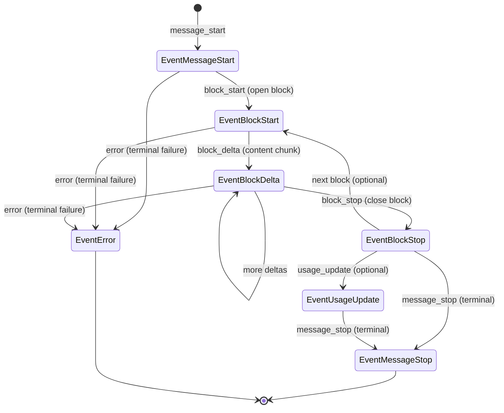

# Adapter Developer Guide

This document describes how to implement, register, and test protocol adapters for the Universal LLM Gateway (`internal/gateway/*`).

---

## 1. Architecture Overview

The Universal LLM Gateway connects client-facing applications to diverse upstream model providers. A naive design requires $N \times M$ pairwise translators between $N$ inbound client protocols and $M$ outbound provider protocols:

```
[Anthropic Client] ----\                  /---> [Anthropic API]
[OpenAI Chat]      -----> [N x M Matrix] -----> [OpenAI API]
[OpenAI Responses] ----/                  \---> [Gemini / Custom]
```

The gateway eliminates this combinatorial explosion by using a **hub-and-spoke** architecture centered on a normalized, protocol-neutral **Intermediate Representation (IR)**:

```
                          +------------------------+
Inbound Protocol          |  Intermediate Repr.   |        Outbound Protocol
                          |     (`ir.Request`)     |
[Anthropic Inbound]  ---> |                        | ---> [Anthropic Outbound]
[OpenAI Chat Inbound]---> |      ir.Response       | ---> [OpenAI Chat Outbound]
[Responses Inbound]  ---> |      ir.StreamEvent    | ---> [Custom Outbound]
                          +------------------------+
```

### Passthrough vs. Translation

- **Passthrough Relay (Zero-Copy):** When the client's inbound protocol matches the upstream provider's native protocol (e.g., OpenAI Chat in $\to$ OpenAI Chat out), the gateway **bypasses adapter translation entirely**. The request body is forwarded verbatim and the upstream response stream is relayed directly through `internal/gateway/core` relay. This ensures maximum throughput, lowest latency, and zero loss of protocol-specific nuances.
- **Translation:** When inbound and outbound protocols differ (e.g., Anthropic Messages client calling an OpenAI Chat upstream), the inbound adapter decodes the request into the IR, and the outbound adapter compiles the IR into the upstream wire request. Responses and stream events are converted symmetrically back into the client's protocol.

### Package Structure and Isolation

To prevent coupling and enable independent contribution:

| Path | Responsibility |
|---|---|
| `internal/gateway/ir` | Normalized types (`Request`, `Response`, `Block`, `StreamEvent`). Has zero external framework, HTTP, or Gin dependencies. |
| `internal/gateway/adapter` | Core interfaces (`Inbound`, `Outbound`, `Stream`), capability flags, registry, and dispatch types. |
| `internal/gateway/inbound/<proto>` | Inbound adapters decoding client wire requests and encoding gateway responses/SSE. |
| `internal/gateway/outbound/<proto>` | Outbound adapters encoding upstream requests, decoding responses/SSE, and declaring protocol capabilities. |
| `internal/gateway/gwerr` | Canonical gateway error kinds, status mapping, secret scrubbing, and protocol wire error encoders. |
| `internal/gateway/adaptertest` | Reusable contract and conformance test runners for both inbound and outbound adapters. |

Adapters **never import each other**. The IR and adapter contracts are the only integration contracts across protocols.

---

## 2. Intermediate Representation (IR)

The IR in `internal/gateway/ir` models the capabilities of supported LLM protocols without favoring any single vendor.

### Core Types

- `ir.Request`: Protocol-neutral completion request.
  - `Model string`: Target model requested by the client.
  - `Instructions []Instruction`: System or developer prompt blocks. Preserves distinct `InstructionRole` ("system" vs "developer") and ordering.
  - `Messages []Message`: Conversational turns (`RoleUser`, `RoleAssistant`, `RoleTool`).
  - `Tools []Tool`: Tool/function specifications with raw JSON Schema (`json.RawMessage`).
  - `ToolChoice *ToolChoice`: Invocation policy (`auto`, `none`, `any`/`required`, or `tool`).
  - `Sampling Sampling`: Optional parameters (`Temperature`, `TopP`, `TopK`, `Stop`, `MaxOutputTokens`, `Seed`). Missing parameters remain `nil` rather than zero-valued.
  - `ResponseFormat *ResponseFormat`: Structured output constraints (`text`, `json_object`, or `json_schema`).
  - `Reasoning *ReasoningConfig`: Extended thinking configuration and token budgets.
  - `Stream bool`: Whether streaming SSE is requested.
  - `StreamIncludeUsage bool`: Whether token usage should be emitted in stream updates.
  - `Extensions map[string]json.RawMessage`: Unmodeled provider-specific fields (e.g., Anthropic prompt caching parameters, OpenAI service tiers). Preserved verbatim so round-tripping loses no data.

- `ir.Response`: Protocol-neutral non-streaming response.
  - `ID string`: Unique response identifier.
  - `Model string`: Model that generated the response.
  - `Content []Block`: Sequence of content blocks produced.
  - `StopReason StopReason`: Normalized termination condition (`StopEndTurn`, `StopMaxTokens`, `StopSequence`, `StopToolUse`, `StopContentFilter`, `StopError`).
  - `StopSequence *string`: The specific stop sequence string if matched.
  - `Usage Usage`: Token counts (`InputTokens`, `OutputTokens`, `CacheReadTokens`, `CacheWriteTokens`, `ReasoningTokens`).

- `ir.Block`: Content component inside a message, response, or tool outcome.
  - `Type BlockType`: Selector: `BlockText`, `BlockImage`, `BlockToolUse`, `BlockToolResult`, `BlockReasoning`.
  - Constructors ensure payload consistency:
    - `ir.NewTextBlock(text)`
    - `ir.NewImageBlockURL(url)` / `ir.NewImageBlockBase64(mediaType, data)`
    - `ir.NewToolUseBlock(id, name, inputJSON)`
    - `ir.NewToolResultBlock(toolUseID, content, isError)`
    - `ir.NewReasoningBlock(content, signature)`

- `ir.StreamEvent`: Normalized unit in an active stream.
  - `Type EventType`: Lifecycle event type (`EventMessageStart`, `EventBlockStart`, `EventBlockDelta`, `EventBlockStop`, `EventUsageUpdate`, `EventMessageStop`, `EventError`).
  - `Index int`: 0-indexed block slot that the delta or stop applies to.
  - `Delta *Delta`: Incremental payload carrying `DeltaText`, `DeltaToolArguments`, `DeltaReasoning`, or `DeltaSignature`.

### Design Invariants

1. **Typed Structs over Untyped Maps:** Avoid `map[string]any`. Unknown parameters must ride in `Request.Extensions`.
2. **Pointers for Optional Wire Fields:** A pointer distinguishes an explicitly configured `0` or `false` from a parameter that was omitted.
3. **Verbatim IDs and Schemas:** Tool call IDs and JSON argument fragments are passed without normalization, preserving dialect variations and partial chunk boundaries.
4. **No HTTP or Framework Imports:** `internal/gateway/ir` is a pure Go domain package.

---

## 3. Interface Contracts

Adapters implement interfaces defined in `internal/gateway/adapter`. All implementations must be safe for concurrent use across requests and maintain no mutable request state.

### Inbound Codec Contract (`adapter.Inbound`)

```go
type Inbound interface {
    // Protocol reports the wire protocol this adapter speaks.
    Protocol() ir.Protocol

    // DecodeRequest parses an incoming HTTP request into the normalized IR.
    // The adapter owns req.Body during execution.
    DecodeRequest(req *http.Request) (*ir.Request, error)

    // EncodeResponse serializes a completed IR response into wire bytes.
    EncodeResponse(resp *ir.Response) ([]byte, error)

    // EncodeStream translates a normalized pull-based Stream into SSE frames
    // written to w. Returns on the terminal event or upon write error.
    EncodeStream(ctx context.Context, events Stream, w *sse.Writer) error
}
```

### Outbound Adapter Contract (`adapter.Outbound`)

```go
type Outbound interface {
    // Protocol reports the upstream provider protocol.
    Protocol() ir.Protocol

    // Capabilities describes what the upstream protocol can express.
    Capabilities() Capabilities

    // BuildRequest creates the upstream HTTP request for target t.
    // Headers in t are already resolved and authenticated; copy them verbatim.
    BuildRequest(ctx context.Context, req *ir.Request, t Target) (*http.Request, error)

    // ParseResponse converts an upstream HTTP response into a normalized IR response.
    // Must return a *gwerr.Error for upstream error status codes.
    ParseResponse(resp *http.Response) (*ir.Response, error)

    // ParseStream converts an upstream HTTP SSE response into a normalized Stream.
    ParseStream(ctx context.Context, resp *http.Response) (Stream, error)
}
```

### Stream Interface (`adapter.Stream`)

```go
type Stream interface {
    // Next blocks until the next event arrives, io.EOF is encountered,
    // the context is cancelled, or an upstream error occurs.
    Next(ctx context.Context) (ir.StreamEvent, error)

    // Close releases upstream resources and closes response bodies.
    Close() error
}
```

### Capabilities Contract (`adapter.Capabilities`)

Upstream capabilities are validated before dispatch:

```go
type Capabilities struct {
    Streaming         bool            // Supports Server-Sent Events
    Tools             bool            // Supports tool definitions and invocations
    ParallelToolCalls bool            // Supports multiple tool calls per turn
    Images            ImageCapability // none | base64 | url | both
    Reasoning         bool            // Supports thinking/reasoning blocks
    StructuredOutput  bool            // Supports JSON mode and JSON Schema
    TopK              bool            // Supports top-k sampling parameter
    StatefulResponses bool            // Supports server-side conversation state
    CountTokens       bool            // Provides dedicated token counting endpoint
    MaxImageBytes     int64
    AllowedMediaTypes []string
}
```

If an inbound request requires a capability that the target outbound adapter lacks, the gateway's policy engine (`internal/gateway/policy`) will either reject the request with `gwerr.KindInvalidRequest` or drop/sanitize unsupported parameters according to configured provider policy.

### Target Resolution (`adapter.Target`)

```go
type Target struct {
    BaseURL string      // Target URL without trailing slash (e.g. "https://api.openai.com/v1")
    Model   string      // Upstream provider model alias
    Headers http.Header // Resolved headers (auth, forwarded headers, stripped client secrets)
}
```

> [!IMPORTANT]
> Outbound adapters **must never generate or overwrite authentication headers**. All credentials and policy headers are pre-populated in `Target.Headers`. Copy `Target.Headers` directly into the outgoing HTTP request.

---

## 4. Adapter Registration and Dispatch

### Registry

Adapters register with an instance of `adapter.Registry` (`internal/gateway/adapter/registry.go`):

```go
registry := adapter.NewRegistry()
registry.RegisterInbound(inboundanthropic.New())
registry.RegisterInbound(inboundchat.New())
registry.RegisterOutbound(outboundanthropic.New())
registry.RegisterOutbound(outboundchat.New())
```

Registration panics if:
- An adapter instance is `nil`.
- A protocol is registered more than once.

### Wiring Point (`cmd/serve`)

All production adapters are registered explicitly in `cmd/serve/gateway_dispatch.go`.

> [!WARNING]
> Never register adapters inside `init()` functions. Explicit registration in `cmd/serve` prevents initialization ordering bugs, enables parallel adapter development, and prevents silent race conditions.

### Dispatcher Routing

When an incoming HTTP request hits the gateway:
1. `routeProtocol(path)` identifies the inbound protocol from endpoint URL:
   - `/v1/chat/completions` $\to$ `ir.ProtocolOpenAIChat`
   - `/v1/messages` $\to$ `ir.ProtocolAnthropicMessages`
   - `/v1/responses` $\to$ `ir.ProtocolOpenAIResponses`
2. The model routing engine (`routing.Resolver`) resolves the requested model to a target `provider.Provider` and upstream model name.
3. If `inbound.Protocol() == provider.Protocol`, dispatch routes through the zero-copy passthrough relay.
4. If protocols differ, dispatch invokes `translation.Serve` (for standard requests) or `translation.ServeStream` (for streaming requests).

---

## 5. Streaming Invariants

Streaming across protocols requires strict event sequencing. Both outbound parsers (which produce events) and inbound encoders (which consume events) must adhere to these invariants.

### Event Lifecycle Sequencing

Every valid stream event sequence follows this deterministic lifecycle:



### Invariants Enforced by `ir.ValidateEventOrder`

1. **Start Event:** Exactly one `EventMessageStart` occurs, and it must be the first event.
2. **Block Scoping:**
   - Every block must be opened with `EventBlockStart` before any `EventBlockDelta` or `EventBlockStop` referencing its `Index`.
   - No block index may be reopened after being closed by `EventBlockStop`.
   - All opened blocks must be closed with `EventBlockStop` before `EventMessageStop`.
3. **Usage Aggregation:**
   - At most one `EventUsageUpdate` may be sent.
   - When present, it occurs immediately before the terminal event.
4. **Terminal Event Exclusivity:**
   - A stream ends with **exactly one** terminal event: either `EventMessageStop` (carrying a non-empty `StopReason`) or `EventError` (carrying a non-nil `*StreamError`).
   - Never emit both. No events may be produced or consumed after the terminal event.

### Error Handling Mid-Stream

- **Provider-Reported Failure:** If the upstream sends an SSE error frame mid-stream, the outbound adapter produces an `ir.EventError` event. This gives the inbound encoder the opportunity to format and flush a protocol-native SSE error before closing the connection.
- **Network / Transport Drop:** If the underlying connection terminates abruptly, `Stream.Next(ctx)` returns the raw I/O error (`io.ErrUnexpectedEOF`, context cancellation, etc.).

---

## 6. Error Mapping

Normalized gateway errors are represented by `*gwerr.Error` in `internal/gateway/gwerr`.

### Canonical Error Kinds

| Kind | HTTP Status | Meaning |
|---|---|---|
| `KindInvalidRequest` | 400 | Malformed syntax, invalid parameters, or unsupported features |
| `KindAuthentication` | 401 | Missing, expired, or invalid credentials |
| `KindPermission` | 403 | Quota exhausted, project unauthorized, or forbidden model |
| `KindNotFound` | 404 | Unknown model alias or non-existent endpoint |
| `KindRateLimit` | 429 | Upstream or local rate limits triggered |
| `KindOverloaded` | 503 | Provider is under capacity or temporarily unavailable |
| `KindTimeout` | 504 | Upstream dial, TLS handshake, or request deadline exceeded |
| `KindUpstreamError` | 502 | Upstream returned a 5xx response or bad payload |
| `KindInternal` | 500 | Unhandled internal gateway invariant violation |

### Status Code Mapping Helpers

- `gwerr.StatusForKind(kind)` maps a `gwerr.Kind` to its standard HTTP status code.
- `gwerr.KindFromHTTPStatus(statusCode)` maps an upstream HTTP status code to the appropriate gateway `Kind`.
- `gwerr.KindFromErr(err)` classifies an unknown Go error into a `gwerr.Kind`.

### Secret Scrubbing

To prevent credential leakage in error messages and logs:
- `Scrub(message, secrets...)` masks sensitive tokens with `[redacted]`.
- Outbound adapters automatically register active upstream keys with `redact.Default`.

### Wire Error Encoders

Inbound adapters do not write error bodies directly. The gateway dispatcher formats errors using `gwerr`:
- `gwerr.Encode(proto, err)` returns the protocol-specific JSON body and status.
- `gwerr.Write(w, proto, err)` sends HTTP headers (`Content-Type`, `Retry-After`, `X-Request-ID`) and writes the error JSON.
- `gwerr.WriteSSEError(w, proto, err, responseID)` writes terminal streaming error SSE frames.

---

## 7. Contract and Conformance Test Suites

The gateway provides automated conformance test harnesses in `internal/gateway/adaptertest`. Any new adapter can verify full protocol compliance without running a live HTTP server or mock network stack.

### Running Conformance Tests

To test an inbound adapter:

```go
func TestInboundContract(t *testing.T) {
    adaptertest.RunInboundContract(t, myinbound.New(), "testdata")
}
```

To test an outbound adapter:

```go
func TestOutboundContract(t *testing.T) {
    adaptertest.RunOutboundContract(t, myoutbound.New(), "testdata")
}
```

### Fixture Manifest Schema

The `testdata/` directory contains JSON manifests:

- **`inbound.json`:**
  - `decode`: Tests decoding wire requests into expected IR files (supports error rejection cases).
  - `responses`: Tests encoding IR responses into golden wire JSON.
  - `streams`: Tests encoding IR event sequences into golden SSE streams.
  - `errors`: Tests rendering normalized gateway errors into protocol wire formats.

- **`outbound.json`:**
  - `requests`: Tests compiling IR requests and `adapter.Target` into outgoing HTTP requests and golden headers/bodies.
  - `responses`: Tests parsing upstream responses into IR or `*gwerr.Error`.
  - `streams`: Tests parsing upstream SSE responses into `ir.StreamEvent` sequences.

### Shared Canonical Fixtures

Protocols can reuse shared canonical IR fixtures located in:
`internal/gateway/testdata/adapter-contract/canonical/`
- `request.json`
- `response.json`
- `events.json`
- `error-events.json`

### Updating Goldens with `-update`

Register test flags in `TestMain`:

```go
func TestMain(m *testing.M) {
    adaptertest.RegisterFlags()
    os.Exit(m.Run())
}
```

Run test suite with `-update` to refresh wire goldens:

```bash
go test ./internal/gateway/inbound/<proto> -args -update
go test ./internal/gateway/outbound/<proto> -args -update
```

---

## 8. Compilable Worked Example

The following minimal example demonstrates a custom protocol adapter implementing `adapter.Inbound` and `adapter.Outbound`.

This code is verified by unit tests in [`internal/gateway/adapter/example_test.go`](file:///internal/gateway/adapter/example_test.go).

### Inbound Adapter Implementation

```go
package myadapter

import (
    "context"
    "encoding/json"
    "fmt"
    "net/http"

    "github.com/minhhhduc/gnvipi/internal/gateway/adapter"
    "github.com/minhhhduc/gnvipi/internal/gateway/gwerr"
    "github.com/minhhhduc/gnvipi/internal/gateway/ir"
    "github.com/minhhhduc/gnvipi/internal/gateway/sse"
)

const ProtocolCustom ir.Protocol = "custom-protocol"

type CustomInbound struct{}

var _ adapter.Inbound = (*CustomInbound)(nil)

func (CustomInbound) Protocol() ir.Protocol {
    return ProtocolCustom
}

type customInboundRequest struct {
    Model  string `json:"model"`
    Prompt string `json:"prompt"`
}

func (CustomInbound) DecodeRequest(req *http.Request) (*ir.Request, error) {
    var body customInboundRequest
    if err := json.NewDecoder(req.Body).Decode(&body); err != nil {
        return nil, &gwerr.Error{
            Kind:    gwerr.KindInvalidRequest,
            Message: "invalid JSON payload: " + err.Error(),
        }
    }
    if body.Prompt == "" {
        return nil, &gwerr.Error{
            Kind:    gwerr.KindInvalidRequest,
            Message: "missing required field: prompt",
        }
    }
    return &ir.Request{
        Model: body.Model,
        Messages: []ir.Message{
            ir.NewMessage(ir.RoleUser, ir.NewTextBlock(body.Prompt)),
        },
    }, nil
}

type customInboundResponse struct {
    ID           string `json:"id"`
    Model        string `json:"model"`
    Output       string `json:"output"`
    FinishReason string `json:"finish_reason"`
    Tokens       int    `json:"tokens"`
}

func (CustomInbound) EncodeResponse(resp *ir.Response) ([]byte, error) {
    text := ""
    if len(resp.Content) > 0 {
        text = resp.Content[0].Text
    }
    wire := customInboundResponse{
        ID:           resp.ID,
        Model:        resp.Model,
        Output:       text,
        FinishReason: string(resp.StopReason),
        Tokens:       resp.Usage.OutputTokens,
    }
    return json.Marshal(wire)
}

func (CustomInbound) EncodeStream(ctx context.Context, events adapter.Stream, w *sse.Writer) error {
    for {
        ev, err := events.Next(ctx)
        if err != nil {
            return err
        }

        var frame sse.Event
        switch ev.Type {
        case ir.EventMessageStart:
            data, err := json.Marshal(map[string]string{
                "id":    ev.Message.ID,
                "model": ev.Message.Model,
            })
            if err != nil {
                return err
            }
            frame = sse.Event{Type: "start", Data: string(data)}
        case ir.EventBlockDelta:
            data, err := json.Marshal(map[string]string{
                "text": ev.Delta.Text,
            })
            if err != nil {
                return err
            }
            frame = sse.Event{Type: "delta", Data: string(data)}
        case ir.EventUsageUpdate:
            data, err := json.Marshal(map[string]int{
                "output_tokens": ev.Usage.OutputTokens,
            })
            if err != nil {
                return err
            }
            frame = sse.Event{Type: "usage", Data: string(data)}
        case ir.EventMessageStop:
            frame = sse.Event{Type: "stop", Data: fmt.Sprintf(`{"reason":%q}`, ev.StopReason)}
        case ir.EventError:
            data, err := json.Marshal(map[string]string{
                "kind":    ev.Error.Kind,
                "message": ev.Error.Message,
            })
            if err != nil {
                return err
            }
            frame = sse.Event{Type: "error", Data: string(data)}
        default:
            continue
        }

        if err := w.WriteEvent(frame); err != nil {
            return err
        }

        if ev.Type == ir.EventMessageStop || ev.Type == ir.EventError {
            return nil
        }
    }
}
```

### Outbound Adapter Implementation

```go
type CustomOutbound struct{}

var _ adapter.Outbound = (*CustomOutbound)(nil)

func (CustomOutbound) Protocol() ir.Protocol {
    return ProtocolCustom
}

func (CustomOutbound) Capabilities() adapter.Capabilities {
    return adapter.Capabilities{
        Streaming: true,
    }
}

func (CustomOutbound) BuildRequest(ctx context.Context, req *ir.Request, t adapter.Target) (*http.Request, error) {
    prompt := ""
    if len(req.Messages) > 0 && len(req.Messages[0].Content) > 0 {
        prompt = req.Messages[0].Content[0].Text
    }

    payload, err := json.Marshal(map[string]string{
        "model":  t.Model,
        "prompt": prompt,
    })
    if err != nil {
        return nil, err
    }

    httpReq, err := http.NewRequestWithContext(
        ctx,
        http.MethodPost,
        t.BaseURL+"/v1/generate",
        bytes.NewReader(payload),
    )
    if err != nil {
        return nil, err
    }

    httpReq.Header = t.Headers.Clone()
    httpReq.Header.Set("Content-Type", "application/json")
    return httpReq, nil
}

func (CustomOutbound) ParseResponse(resp *http.Response) (out *ir.Response, err error) {
    defer func() {
        if closeErr := resp.Body.Close(); closeErr != nil && err == nil {
            err = closeErr
        }
    }()

    if resp.StatusCode >= 400 {
        var errPayload struct {
            Message string `json:"message"`
        }
        if err := json.NewDecoder(resp.Body).Decode(&errPayload); err != nil {
            return nil, &gwerr.Error{
                Kind:           gwerr.KindFromHTTPStatus(resp.StatusCode),
                Status:         resp.StatusCode,
                UpstreamStatus: resp.StatusCode,
                Message:        "upstream error with status " + resp.Status,
            }
        }
        return nil, &gwerr.Error{
            Kind:           gwerr.KindFromHTTPStatus(resp.StatusCode),
            Status:         resp.StatusCode,
            UpstreamStatus: resp.StatusCode,
            Message:        errPayload.Message,
        }
    }

    var data struct {
        ID     string `json:"id"`
        Model  string `json:"model"`
        Result string `json:"result"`
        Tokens int    `json:"tokens"`
    }
    if err := json.NewDecoder(resp.Body).Decode(&data); err != nil {
        return nil, err
    }

    res := ir.NewTextResponse(data.ID, data.Model, data.Result, ir.Usage{
        OutputTokens: data.Tokens,
    })
    return &res, nil
}

type customStream struct {
    reader *sse.Reader
    body   io.Closer
}

func (s *customStream) Next(ctx context.Context) (ir.StreamEvent, error) {
    for {
        event, err := s.reader.Next(ctx)
        if err != nil {
            return ir.StreamEvent{}, err
        }

        switch event.Type {
        case "start":
            var p struct {
                ID    string `json:"id"`
                Model string `json:"model"`
            }
            if err := json.Unmarshal([]byte(event.Data), &p); err != nil {
                return ir.StreamEvent{}, err
            }
            return ir.NewMessageStart(p.ID, ir.RoleAssistant, p.Model, ir.Usage{}), nil
        case "token":
            var p struct {
                Text string `json:"text"`
            }
            if err := json.Unmarshal([]byte(event.Data), &p); err != nil {
                return ir.StreamEvent{}, err
            }
            return ir.NewTextDelta(0, p.Text), nil
        case "stop":
            return ir.NewMessageStop(ir.StopEndTurn), nil
        case "error":
            var p struct {
                Kind    string `json:"kind"`
                Message string `json:"message"`
            }
            if err := json.Unmarshal([]byte(event.Data), &p); err != nil {
                return ir.StreamEvent{}, err
            }
            return ir.NewErrorEvent(p.Kind, p.Message), nil
        }
    }
}

func (s *customStream) Close() error {
    if s.body != nil {
        return s.body.Close()
    }
    return nil
}

func (CustomOutbound) ParseStream(_ context.Context, resp *http.Response) (adapter.Stream, error) {
    reader := sse.NewReader(resp.Body)
    return &customStream{reader: reader, body: resp.Body}, nil
}
```

### Verification and Registration Test

```go
func TestCustomAdapter(t *testing.T) {
    reg := adapter.NewRegistry()
    in := CustomInbound{}
    out := CustomOutbound{}

    reg.RegisterInbound(in)
    reg.RegisterOutbound(out)

    inAdapter, _ := reg.Inbound(ProtocolCustom)
    outAdapter, _ := reg.Outbound(ProtocolCustom)

    // Decode request into IR
    req := httptest.NewRequestWithContext(context.Background(), http.MethodPost, "/v1/chat", strings.NewReader(`{"model":"custom-v1","prompt":"hello"}`))
    irReq, err := inAdapter.DecodeRequest(req)
    if err != nil {
        t.Fatalf("DecodeRequest: %v", err)
    }

    // Build outbound upstream request
    target := adapter.Target{BaseURL: "https://upstream.invalid", Model: "custom-v1", Headers: http.Header{}}
    httpReq, err := outAdapter.BuildRequest(context.Background(), irReq, target)
    if err != nil {
        t.Fatalf("BuildRequest: %v", err)
    }
    _ = httpReq
}
```

Run tests to verify compilation and execution:

```bash
go test -v -race ./internal/gateway/adapter -run "TestExample"
```
