# Universal LLM API Gateway — Architecture & Implementation Roadmap

> **Tracking Issue:** [#65](https://github.com/minhhhduc/gnvipi/issues/65)  
> **Status:** Planning / Published Backlog  
> **Repository:** [minhhhduc/gnvipi](https://github.com/minhhhduc/gnvipi)  
> **Target Release:** Universal LLM Gateway v2.0  

---

## 1. Repository Analysis

### 1.1 Technology Stack & Structure
The current repository (`gnvipi`) is implemented in **Go 1.26** using:
- **HTTP Transport / Routing:** `gin-gonic/gin` v1.10.1 combined with embedded `router-for-me/CLIProxyAPI/v7` (v7.2.97).
- **Automation / Captcha:** `chromedp/chromedp` v0.16.0 controlling headless Chrome workers to solve hCaptcha tokens for NVIDIA Playground API.
- **Fingerprint / WAF Evasion:** `refraction-networking/utls` and `golang.org/x/net/http2` for Chrome TLS ClientHello matching.
- **JSON / Data Manipulation:** `tidwall/sjson`, `tidwall/gjson`, and standard library encoders.
- **CI / Quality:** GitHub Actions testing on Ubuntu, macOS, and Windows with `-race -vet=all`, `golangci-lint`, and `govulncheck`.

### 1.2 Existing Server Architecture
The service boots via `cmd/serve/main.go`:
1. Embedded **CLIProxyAPI** acts as the primary reverse-proxy core and registers default handlers for `/v1/chat/completions`, `/v1/responses`, and `/v1/messages`.
2. A custom provider executor `internal/provider/nvidia/executor.go` translates OpenAI-shaped calls into NVIDIA Playground predict calls, leasing short-lived single-use captcha tokens from `internal/captcha/pool.go`.
3. An administrative dashboard (`/admin`) serves HTML/CSS/JS for toggling model visibility masks, configuring model cycling (`cycle`), Claude automatic model alias (`automode`), and web search (MCP).
4. Custom providers added through `/admin?page=models` are handled through bespoke Gin middlewares installed ahead of CLIProxyAPI in `cmd/serve/main.go` and `cmd/serve/passthrough.go`.

### 1.3 What Already Works and Can Be Reused
- **SSE Stream Coalescing:** `internal/provider/nvidia/coalesce.go` provides proven delta-merging mechanics.
- **WAF Bypass Transport:** `messagesOnlyDialTLS` in `cmd/serve/passthrough.go` pairs Chrome ClientHello uTLS with HTTP/2.
- **Model Registry & Masking:** `internal/models/registry.go` cleanly maps models and capability flags.
- **Virtual Model Policies:** `cmd/serve/cycle.go` and `claudeAutoModelAlias` provide battle-tested fallback and auto-routing concepts.
- **Claude Code Model Discovery:** `writeClaudeModelCache` correctly manages the local client cache directory.

### 1.4 Architectural Limitations & Gaps in Current Architecture
1. **Tight Coupling to CLIProxyAPI:** Inbound translation is delegated to CLIProxyAPI's internal engine, which forces custom providers through an OpenAI-compat executor that only calls `/v1/chat/completions`.
2. **Duplicated, Fragile Passthrough Paths:** Three separate middleware functions in `cmd/serve/passthrough.go` independently read bodies, reconstruct requests, and proxy responses with inconsistent header filtering and error formats.
3. **Missing Uniform Protocol Translation:** An Anthropic client cannot access an OpenAI Responses or custom upstream without fragile ad-hoc middlewares (`responses_anthropic.go`).
4. **Security Vulnerabilities:**
   - Unauthenticated administrative routes (`/admin/*`) allow remote mutation and CSRF attacks.
   - Provider API keys are persisted in plaintext in the catalog file (`playground_models.json`) and exposed to browsers.
   - Arbitrary upstream URLs are dialed without SSRF guards (cloud metadata 169.254.169.254, link-local).
5. **Reliability Risks:** Upstream HTTP clients have no request deadlines; stalled upstreams can exhaust server resources indefinitely.

---

## 2. Proposed Architecture

The evolved Universal LLM Gateway establishes a strict **Adapter-Hub** architecture centered on a normalized Internal Representation (IR). Individual clients and providers are completely decoupled:

```
┌────────────────────────────────────────────────────────────────────────┐
│                        Client Applications                             │
│   (Claude Code, OpenAI Python/JS SDK, Codex, OpenCode, Aider, etc.)    │
└────────────────────────────────────┬───────────────────────────────────┘
                                     │ HTTP Request (SSE or JSON)
                                     ▼
┌────────────────────────────────────────────────────────────────────────┐
│                          Gateway Inbound Layer                         │
│  ┌───────────────────────┬──────────────────────┬────────────────────┐ │
│  │   Anthropic Messages  │  OpenAI Chat Compl.  │  OpenAI Responses  │ │
│  │   POST /v1/messages   │ POST /chat/complet.  │ POST /v1/responses │ │
│  └───────────┬───────────┴──────────┬───────────┴──────────┬─────────┘ │
└──────────────┼──────────────────────┼──────────────────────┼───────────┘
               │                      │                      │
               ▼                      ▼                      ▼
┌────────────────────────────────────────────────────────────────────────┐
│                    Gateway Core: Inbound Adapters                      │
│             (Decode wire protocol into normalized IR)                  │
└────────────────────────────────────┬───────────────────────────────────┘
                                     │
                                     ▼
┌────────────────────────────────────────────────────────────────────────┐
│               Gateway Core: Dispatcher & Context Engine                │
│  - Request Context, Correlation IDs, Body Limits (MaxBytes)            │
│  - Inbound Authentication (Bearer / x-api-key)                         │
│  - Model Resolver & Prefix Routing (Exact Alias, Wildcard, Fallback)   │
└──────────────────┬─────────────────┬─────────────────┬─────────────────┘
                   │                 │                 │
     Same-Protocol │   Cross-Protocol│   NVIDIA Models │
     Passthrough   │   Translation   │   (Unchanged)   │
                   ▼                 ▼                 ▼
┌────────────────────┐ ┌───────────────────────────┐ ┌───────────────────┐
│ Same-Proto Relay   │ │ Outbound Adapter Registry │ │ CLIProxyAPI &     │
│ (Byte-for-byte     │ │ - OpenAI Chat Builder     │ │ NVIDIA Executor   │
│  streaming relay)  │ │ - Anthropic Builder       │ │ (hCaptcha Pool    │
│                    │ │ - Responses Builder       │ │  & Predict API)   │
└─────────┬──────────┘ └─────────────┬─────────────┘ └─────────┬─────────┘
          │                          │                         │
          └──────────────────────────┼─────────────────────────┘
                                     │
                                     ▼
┌────────────────────────────────────────────────────────────────────────┐
│                  Shared Upstream Client & Reliability                  │
│  - Bounded Connect / Response-Header Timeouts & Idle Stream Watchdog   │
│  - SSRF Prevention (Private / Cloud Metadata Guard)                    │
│  - Safe Pre-Stream Retry & Concurrency Limiting                        │
│  - Secret Redaction Filter                                             │
└────────────────────────────────────┬───────────────────────────────────┘
                                     │
                                     ▼
┌────────────────────────────────────────────────────────────────────────┐
│                         Upstream Providers                             │
│   (Anthropic API, OpenAI, OpenRouter, DeepSeek, Local Ollama/vLLM)     │
└────────────────────────────────────────────────────────────────────────┘
```

### Component Responsibilities

#### A. Gateway Core
- **HTTP Server Lifecycle:** Manages graceful startup, shutdown, and route registration without port conflicts.
- **Request Dispatcher (`internal/gateway/dispatch`):** Inspects incoming routes, attaches request-scoped context, coordinates decode-execute-encode cycles, and safely handles client disconnects.
- **Normalized Internal Representation (`internal/gateway/ir`):** Defines typed structures for `Request`, `Response`, `StreamEvent`, `ContentBlock`, and `StopReason`.
- **Error Model (`internal/gateway/gwerr`):** Translates internal errors into canonical Anthropic, OpenAI Chat, or OpenAI Responses error payloads.

#### B. Inbound Protocol Adapters (`internal/gateway/inbound/`)
- Decode inbound HTTP requests into canonical `ir.Request`.
- Encode `ir.Response` into client-specific JSON responses.
- Encode an `ir.StreamEvent` iterator into spec-compliant Server-Sent Events (SSE).
- Handle protocol-specific nuances (e.g. `POST /v1/messages/count_tokens`).

#### C. Outbound Provider Adapters (`internal/gateway/outbound/`)
- Build upstream HTTP requests from `ir.Request` with target provider headers and URLs.
- Parse upstream JSON responses into `ir.Response`.
- Parse upstream SSE chunks into standard `ir.StreamEvent` sequences.
- Expose an extensible decorator interface for provider-specific quirks (custom endpoints, headers).

#### D. Provider Management & Security (`internal/gateway/provider/`)
- Typed configuration schema v2 supporting multiple model mappings per provider, protocol selection, and header policies.
- Isolated secrets storage ensuring API keys are never exposed via admin UI, logs, or catalog files.
- SSRF defenses blocking cloud metadata (169.254.169.254) and forbidden IP ranges at parse and dial time.

#### E. Routing Engine (`internal/gateway/routing/`)
- Resolves client model strings using exact alias matching, wildcard prefixes (`provider/*`), and fallback candidates.
- Integrates virtual models (`automode`, `cycle`) across all inbound protocols.
- Dynamically publishes the `/v1/models` catalog with provider capability metadata.

#### F. Streaming & Feature Compatibility
- Bi-directional Server-Sent Events handling with automatic flushing, ping keepalives, and mid-stream error formatting.
- Tool use translation across Anthropic (`tool_use` / `tool_result`), OpenAI Chat (`tool_calls`), and OpenAI Responses (`function_call`).
- Reasoning/thinking token and effort level mapping.
- Multimodal image format conversions (Data URLs <-> Base64 Source objects).

---

## 3. Milestone Breakdown & Complete Issue Index

All 64 implementation tasks have been created as official GitHub issues on repository [minhhhduc/gnvipi](https://github.com/minhhhduc/gnvipi).

### Phase 1: Architectural Foundations (Milestone 1)
Foundational data structures, SSE parser/writer, normalized error models, adapter interfaces, and test fixtures.
| Issue | Title | Labels | Dependencies |
|---|---|---|---|
| [#1](https://github.com/minhhhduc/gnvipi/issues/1) | [gateway] Define normalized internal representation (IR) for requests, responses and stream events | `architecture`, `core` | None (Foundation) |
| [#2](https://github.com/minhhhduc/gnvipi/issues/2) | [gateway] Add reusable SSE reader/writer package | `core`, `streaming` | None (Foundation) |
| [#3](https://github.com/minhhhduc/gnvipi/issues/3) | [gateway] Define normalized gateway error model and per-protocol error encoders | `core`, `protocol` | None (Foundation) |
| [#4](https://github.com/minhhhduc/gnvipi/issues/4) | [gateway] Define inbound/outbound adapter interfaces, capability flags and adapter registry | `architecture`, `adapter` | [#1](https://github.com/minhhhduc/gnvipi/issues/1), [#3](https://github.com/minhhhduc/gnvipi/issues/3) |
| [#5](https://github.com/minhhhduc/gnvipi/issues/5) | [provider] Define provider configuration schema v2 with validation (types only) | `provider`, `architecture` | [#1](https://github.com/minhhhduc/gnvipi/issues/1) |
| [#6](https://github.com/minhhhduc/gnvipi/issues/6) | [testing] Build fake upstream test harness for OpenAI Chat, Anthropic and Responses | `testing` | None (Foundation) |
| [#7](https://github.com/minhhhduc/gnvipi/issues/7) | [testing] Add characterization tests for current custom-provider routing before refactor | `testing`, `routing` | None (Foundation) |

### Phase 2: Gateway Core (Milestone 2)
Shared HTTP client factory, request body limits, header forwarding policies, model resolver, same-protocol relay, and dispatcher middleware.
| Issue | Title | Labels | Dependencies |
|---|---|---|---|
| [#8](https://github.com/minhhhduc/gnvipi/issues/8) | [core] Shared upstream HTTP client factory with timeouts, proxy and TLS profile | `core`, `reliability` | [#5](https://github.com/minhhhduc/gnvipi/issues/5) |
| [#9](https://github.com/minhhhduc/gnvipi/issues/9) | [core] Enforce request body size limits on gateway and admin routes | `core`, `security`, `reliability` | [#3](https://github.com/minhhhduc/gnvipi/issues/3) |
| [#10](https://github.com/minhhhduc/gnvipi/issues/10) | [core] Request context, request IDs and unified usage/stats recorder for the gateway pipeline | `core` | [#1](https://github.com/minhhhduc/gnvipi/issues/1) |
| [#11](https://github.com/minhhhduc/gnvipi/issues/11) | [core] Upstream header policy: allow-list forwarding and provider auth injection | `core`, `security`, `provider` | [#5](https://github.com/minhhhduc/gnvipi/issues/5) |
| [#12](https://github.com/minhhhduc/gnvipi/issues/12) | [routing] Model resolver interface and legacy-provider-backed implementation | `routing`, `core` | [#5](https://github.com/minhhhduc/gnvipi/issues/5) |
| [#13](https://github.com/minhhhduc/gnvipi/issues/13) | [core] Unified same-protocol passthrough relay on the new core | `core`, `streaming` | [#8](https://github.com/minhhhduc/gnvipi/issues/8), [#10](https://github.com/minhhhduc/gnvipi/issues/10), [#11](https://github.com/minhhhduc/gnvipi/issues/11) |
| [#14](https://github.com/minhhhduc/gnvipi/issues/14) | [core] Gateway dispatcher middleware behind -gateway-v2 feature flag | `core`, `routing` | [#4](https://github.com/minhhhduc/gnvipi/issues/4), [#7](https://github.com/minhhhduc/gnvipi/issues/7), [#12](https://github.com/minhhhduc/gnvipi/issues/12), [#13](https://github.com/minhhhduc/gnvipi/issues/13) |
| [#15](https://github.com/minhhhduc/gnvipi/issues/15) | [testing] Adapter contract test suite for inbound and outbound adapters | `testing`, `adapter` | [#4](https://github.com/minhhhduc/gnvipi/issues/4), [#6](https://github.com/minhhhduc/gnvipi/issues/6) |

### Phase 3: Inbound Protocol Adapters (Milestone 3)
Inbound decoders and encoders for Anthropic Messages, OpenAI Chat Completions, and OpenAI Responses.
| Issue | Title | Labels | Dependencies |
|---|---|---|---|
| [#16](https://github.com/minhhhduc/gnvipi/issues/16) | [inbound] Anthropic Messages: request decoding and non-streaming response encoding | `adapter`, `protocol`, `inbound` | [#1](https://github.com/minhhhduc/gnvipi/issues/1), [#3](https://github.com/minhhhduc/gnvipi/issues/3), [#4](https://github.com/minhhhduc/gnvipi/issues/4) |
| [#17](https://github.com/minhhhduc/gnvipi/issues/17) | [inbound] Anthropic Messages: streaming event encoder | `adapter`, `protocol`, `streaming`, `inbound` | [#1](https://github.com/minhhhduc/gnvipi/issues/1), [#2](https://github.com/minhhhduc/gnvipi/issues/2), [#4](https://github.com/minhhhduc/gnvipi/issues/4) |
| [#18](https://github.com/minhhhduc/gnvipi/issues/18) | [inbound] OpenAI Chat Completions: request decoding and non-streaming response encoding | `adapter`, `protocol`, `inbound` | [#1](https://github.com/minhhhduc/gnvipi/issues/1), [#3](https://github.com/minhhhduc/gnvipi/issues/3), [#4](https://github.com/minhhhduc/gnvipi/issues/4) |
| [#19](https://github.com/minhhhduc/gnvipi/issues/19) | [inbound] OpenAI Chat Completions: streaming chunk encoder | `adapter`, `protocol`, `streaming`, `inbound` | [#1](https://github.com/minhhhduc/gnvipi/issues/1), [#2](https://github.com/minhhhduc/gnvipi/issues/2), [#4](https://github.com/minhhhduc/gnvipi/issues/4) |
| [#20](https://github.com/minhhhduc/gnvipi/issues/20) | [inbound] OpenAI Responses: request decoding and non-streaming response encoding | `adapter`, `protocol`, `inbound` | [#1](https://github.com/minhhhduc/gnvipi/issues/1), [#3](https://github.com/minhhhduc/gnvipi/issues/3), [#4](https://github.com/minhhhduc/gnvipi/issues/4) |
| [#21](https://github.com/minhhhduc/gnvipi/issues/21) | [inbound] OpenAI Responses: streaming event encoder | `adapter`, `protocol`, `streaming`, `inbound` | [#1](https://github.com/minhhhduc/gnvipi/issues/1), [#2](https://github.com/minhhhduc/gnvipi/issues/2), [#4](https://github.com/minhhhduc/gnvipi/issues/4) |
| [#22](https://github.com/minhhhduc/gnvipi/issues/22) | [inbound] Anthropic count_tokens for custom providers | `adapter`, `protocol`, `inbound` | [#12](https://github.com/minhhhduc/gnvipi/issues/12), [#16](https://github.com/minhhhduc/gnvipi/issues/16) |

### Phase 4: Outbound Provider Adapters (Milestone 4)
Outbound builders and parsers for OpenAI Chat, Anthropic Messages, OpenAI Responses, and custom endpoints.
| Issue | Title | Labels | Dependencies |
|---|---|---|---|
| [#23](https://github.com/minhhhduc/gnvipi/issues/23) | [outbound] OpenAI Chat upstream adapter: request building and response parsing | `adapter`, `provider`, `outbound` | [#1](https://github.com/minhhhduc/gnvipi/issues/1), [#3](https://github.com/minhhhduc/gnvipi/issues/3), [#4](https://github.com/minhhhduc/gnvipi/issues/4), [#5](https://github.com/minhhhduc/gnvipi/issues/5) |
| [#24](https://github.com/minhhhduc/gnvipi/issues/24) | [outbound] OpenAI Chat upstream adapter: streaming chunk parser | `adapter`, `provider`, `streaming`, `outbound` | [#1](https://github.com/minhhhduc/gnvipi/issues/1), [#2](https://github.com/minhhhduc/gnvipi/issues/2), [#4](https://github.com/minhhhduc/gnvipi/issues/4) |
| [#25](https://github.com/minhhhduc/gnvipi/issues/25) | [outbound] Anthropic Messages upstream adapter: request building and response parsing | `adapter`, `provider`, `outbound` | [#1](https://github.com/minhhhduc/gnvipi/issues/1), [#3](https://github.com/minhhhduc/gnvipi/issues/3), [#4](https://github.com/minhhhduc/gnvipi/issues/4), [#5](https://github.com/minhhhduc/gnvipi/issues/5) |
| [#26](https://github.com/minhhhduc/gnvipi/issues/26) | [outbound] Anthropic Messages upstream adapter: streaming event parser | `adapter`, `provider`, `streaming`, `outbound` | [#1](https://github.com/minhhhduc/gnvipi/issues/1), [#2](https://github.com/minhhhduc/gnvipi/issues/2), [#4](https://github.com/minhhhduc/gnvipi/issues/4) |
| [#27](https://github.com/minhhhduc/gnvipi/issues/27) | [outbound] OpenAI Responses upstream adapter: request building and response parsing | `adapter`, `provider`, `outbound` | [#1](https://github.com/minhhhduc/gnvipi/issues/1), [#3](https://github.com/minhhhduc/gnvipi/issues/3), [#4](https://github.com/minhhhduc/gnvipi/issues/4), [#5](https://github.com/minhhhduc/gnvipi/issues/5) |
| [#28](https://github.com/minhhhduc/gnvipi/issues/28) | [outbound] OpenAI Responses upstream adapter: streaming event parser | `adapter`, `provider`, `streaming`, `outbound` | [#1](https://github.com/minhhhduc/gnvipi/issues/1), [#2](https://github.com/minhhhduc/gnvipi/issues/2), [#4](https://github.com/minhhhduc/gnvipi/issues/4) |
| [#29](https://github.com/minhhhduc/gnvipi/issues/29) | [outbound] Custom provider adapter extension point and endpoint path overrides | `adapter`, `provider`, `architecture`, `outbound` | [#4](https://github.com/minhhhduc/gnvipi/issues/4), [#5](https://github.com/minhhhduc/gnvipi/issues/5) |

### Phase 5: Translation Pipeline and Streaming (Milestone 5)
Core execution pipeline for cross-protocol non-streaming and streaming translation.
| Issue | Title | Labels | Dependencies |
|---|---|---|---|
| [#30](https://github.com/minhhhduc/gnvipi/issues/30) | [core] Generic non-streaming translation pipeline (inbound -> IR -> outbound) | `core`, `protocol` | [#14](https://github.com/minhhhduc/gnvipi/issues/14) |
| [#31](https://github.com/minhhhduc/gnvipi/issues/31) | [streaming] Generic streaming translation pipeline with cancellation, termination and mid-stream errors | `core`, `streaming`, `reliability` | [#2](https://github.com/minhhhduc/gnvipi/issues/2), [#14](https://github.com/minhhhduc/gnvipi/issues/14) |
| [#32](https://github.com/minhhhduc/gnvipi/issues/32) | [protocol] Enable and verify cross-protocol non-streaming matrix with real adapters | `protocol`, `core`, `testing` | [#16](https://github.com/minhhhduc/gnvipi/issues/16), [#18](https://github.com/minhhhduc/gnvipi/issues/18), [#20](https://github.com/minhhhduc/gnvipi/issues/20), [#23](https://github.com/minhhhduc/gnvipi/issues/23), [#25](https://github.com/minhhhduc/gnvipi/issues/25), [#27](https://github.com/minhhhduc/gnvipi/issues/27), [#30](https://github.com/minhhhduc/gnvipi/issues/30) |
| [#33](https://github.com/minhhhduc/gnvipi/issues/33) | [streaming] Enable and verify cross-protocol streaming matrix with real adapters | `streaming`, `protocol`, `testing` | [#17](https://github.com/minhhhduc/gnvipi/issues/17), [#19](https://github.com/minhhhduc/gnvipi/issues/19), [#21](https://github.com/minhhhduc/gnvipi/issues/21), [#24](https://github.com/minhhhduc/gnvipi/issues/24), [#26](https://github.com/minhhhduc/gnvipi/issues/26), [#28](https://github.com/minhhhduc/gnvipi/issues/28), [#31](https://github.com/minhhhduc/gnvipi/issues/31), [#32](https://github.com/minhhhduc/gnvipi/issues/32) |
| [#34](https://github.com/minhhhduc/gnvipi/issues/34) | [protocol] Unsupported feature handling: capability checks, strict/lenient modes and dropped-parameter reporting | `protocol`, `core` | [#30](https://github.com/minhhhduc/gnvipi/issues/30) |

### Phase 6: Provider Configuration and Routing (Milestone 6)
V2 provider storage, secrets redaction, SSRF prevention, admin JSON API, web UI, alias resolution, virtual models, and fallback routing.
| Issue | Title | Labels | Dependencies |
|---|---|---|---|
| [#35](https://github.com/minhhhduc/gnvipi/issues/35) | [provider] Persist provider configuration v2 and migrate legacy custom providers | `provider` | [#5](https://github.com/minhhhduc/gnvipi/issues/5) |
| [#36](https://github.com/minhhhduc/gnvipi/issues/36) | [security] Store provider API keys outside the catalog file and redact them everywhere | `security`, `provider` | [#35](https://github.com/minhhhduc/gnvipi/issues/35) |
| [#37](https://github.com/minhhhduc/gnvipi/issues/37) | [security] Validate provider base URLs and guard against SSRF to metadata/link-local targets | `security`, `provider` | [#5](https://github.com/minhhhduc/gnvipi/issues/5) |
| [#38](https://github.com/minhhhduc/gnvipi/issues/38) | [provider] Provider admin JSON API with validation and connection test | `provider` | [#35](https://github.com/minhhhduc/gnvipi/issues/35), [#36](https://github.com/minhhhduc/gnvipi/issues/36), [#37](https://github.com/minhhhduc/gnvipi/issues/37) |
| [#39](https://github.com/minhhhduc/gnvipi/issues/39) | [provider] Admin UI: provider v2 editor (protocol, model mappings, headers, test button) | `provider` | [#38](https://github.com/minhhhduc/gnvipi/issues/38) |
| [#40](https://github.com/minhhhduc/gnvipi/issues/40) | [routing] Registry-backed resolver: aliases, wildcard mappings and collision precedence | `routing`, `provider` | [#12](https://github.com/minhhhduc/gnvipi/issues/12), [#35](https://github.com/minhhhduc/gnvipi/issues/35) |
| [#41](https://github.com/minhhhduc/gnvipi/issues/41) | [routing] Route virtual models (automode, cycle) through the resolver for all inbound protocols | `routing` | [#40](https://github.com/minhhhduc/gnvipi/issues/40) |
| [#42](https://github.com/minhhhduc/gnvipi/issues/42) | [routing] Per-alias provider fallback policy (pre-stream only) | `routing`, `reliability` | [#30](https://github.com/minhhhduc/gnvipi/issues/30), [#40](https://github.com/minhhhduc/gnvipi/issues/40) |
| [#43](https://github.com/minhhhduc/gnvipi/issues/43) | [routing] Build /v1/models catalog from the provider registry with protocol and capability metadata | `routing`, `provider` | [#40](https://github.com/minhhhduc/gnvipi/issues/40) |

### Phase 7: Tool Calling and Feature Compatibility (Milestone 7)
Advanced feature parity: tool calling, reasoning, multimodal images, and structured outputs across protocols.
| Issue | Title | Labels | Dependencies |
|---|---|---|---|
| [#44](https://github.com/minhhhduc/gnvipi/issues/44) | [protocol] Tool calling mapping for Anthropic Messages (inbound and outbound, incl. streaming) | `protocol`, `adapter`, `streaming` | [#16](https://github.com/minhhhduc/gnvipi/issues/16), [#17](https://github.com/minhhhduc/gnvipi/issues/17), [#25](https://github.com/minhhhduc/gnvipi/issues/25), [#26](https://github.com/minhhhduc/gnvipi/issues/26) |
| [#45](https://github.com/minhhhduc/gnvipi/issues/45) | [protocol] Tool calling mapping for OpenAI Chat Completions (inbound and outbound, incl. streaming) | `protocol`, `adapter`, `streaming` | [#18](https://github.com/minhhhduc/gnvipi/issues/18), [#19](https://github.com/minhhhduc/gnvipi/issues/19), [#23](https://github.com/minhhhduc/gnvipi/issues/23), [#24](https://github.com/minhhhduc/gnvipi/issues/24) |
| [#46](https://github.com/minhhhduc/gnvipi/issues/46) | [protocol] Tool calling mapping for OpenAI Responses (inbound and outbound, incl. streaming) | `protocol`, `adapter`, `streaming` | [#20](https://github.com/minhhhduc/gnvipi/issues/20), [#21](https://github.com/minhhhduc/gnvipi/issues/21), [#27](https://github.com/minhhhduc/gnvipi/issues/27), [#28](https://github.com/minhhhduc/gnvipi/issues/28) |
| [#47](https://github.com/minhhhduc/gnvipi/issues/47) | [protocol] Reasoning/thinking content and effort mapping across protocols | `protocol`, `adapter` | [#32](https://github.com/minhhhduc/gnvipi/issues/32) |
| [#48](https://github.com/minhhhduc/gnvipi/issues/48) | [protocol] Multimodal image input mapping and limits across protocols | `protocol`, `adapter` | [#32](https://github.com/minhhhduc/gnvipi/issues/32) |
| [#49](https://github.com/minhhhduc/gnvipi/issues/49) | [protocol] Structured output (JSON mode / JSON schema) mapping | `protocol`, `adapter` | [#34](https://github.com/minhhhduc/gnvipi/issues/34) |

### Phase 8: Security and Reliability (Milestone 8)
Inbound API key authentication, admin route protection, secret redaction, safe retries, concurrency limits, and atomic persistence.
| Issue | Title | Labels | Dependencies |
|---|---|---|---|
| [#50](https://github.com/minhhhduc/gnvipi/issues/50) | [security] Optional inbound API key authentication for /v1 and /mcp routes | `security`, `core` | None (Foundation) |
| [#51](https://github.com/minhhhduc/gnvipi/issues/51) | [security] Protect admin routes: token or loopback-only access plus CSRF/Origin checks | `security` | None (Foundation) |
| [#52](https://github.com/minhhhduc/gnvipi/issues/52) | [security] Central secret redaction for logs, errors and stats | `security` | [#3](https://github.com/minhhhduc/gnvipi/issues/3) |
| [#53](https://github.com/minhhhduc/gnvipi/issues/53) | [reliability] Safe retry policy for upstream connection failures and rate limits | `reliability`, `core` | [#13](https://github.com/minhhhduc/gnvipi/issues/13) |
| [#54](https://github.com/minhhhduc/gnvipi/issues/54) | [reliability] Per-provider concurrency limits and request isolation tests | `reliability`, `core` | [#14](https://github.com/minhhhduc/gnvipi/issues/14) |
| [#55](https://github.com/minhhhduc/gnvipi/issues/55) | [security] Quote generated CLIProxyAPI YAML and write config files atomically | `security`, `reliability` | None (Foundation) |

### Phase 9: Integration Testing and Compatibility (Milestone 9)
Full cross-protocol matrix test suite (18 combinations), tool conformance suite, client fixtures (Claude Code, OpenAI SDKs, Codex), and security limits.
| Issue | Title | Labels | Dependencies |
|---|---|---|---|
| [#56](https://github.com/minhhhduc/gnvipi/issues/56) | [testing] End-to-end cross-protocol matrix tests (3 inbound x 3 upstream x stream/non-stream) | `testing` | [#6](https://github.com/minhhhduc/gnvipi/issues/6), [#33](https://github.com/minhhhduc/gnvipi/issues/33) |
| [#57](https://github.com/minhhhduc/gnvipi/issues/57) | [testing] Cross-protocol tool calling conformance tests | `testing`, `protocol` | [#44](https://github.com/minhhhduc/gnvipi/issues/44), [#45](https://github.com/minhhhduc/gnvipi/issues/45), [#46](https://github.com/minhhhduc/gnvipi/issues/46), [#56](https://github.com/minhhhduc/gnvipi/issues/56) |
| [#58](https://github.com/minhhhduc/gnvipi/issues/58) | [testing] Client compatibility fixtures for Claude Code, OpenAI SDK and Responses clients | `testing` | [#56](https://github.com/minhhhduc/gnvipi/issues/56) |
| [#59](https://github.com/minhhhduc/gnvipi/issues/59) | [testing] Security and resource-limit test suite | `testing`, `security` | [#8](https://github.com/minhhhduc/gnvipi/issues/8), [#9](https://github.com/minhhhduc/gnvipi/issues/9), [#37](https://github.com/minhhhduc/gnvipi/issues/37), [#50](https://github.com/minhhhduc/gnvipi/issues/50), [#51](https://github.com/minhhhduc/gnvipi/issues/51), [#52](https://github.com/minhhhduc/gnvipi/issues/52) |

### Phase 10: Documentation and Release Readiness (Milestone 10)
Activating v2 as default, legacy code deprecation, comprehensive operator documentation, adapter developer guide, and release notes.
| Issue | Title | Labels | Dependencies |
|---|---|---|---|
| [#60](https://github.com/minhhhduc/gnvipi/issues/60) | [core] Enable gateway-v2 by default and remove legacy custom-provider middleware | `core`, `architecture` | [#7](https://github.com/minhhhduc/gnvipi/issues/7), [#41](https://github.com/minhhhduc/gnvipi/issues/41), [#56](https://github.com/minhhhduc/gnvipi/issues/56), [#57](https://github.com/minhhhduc/gnvipi/issues/57), [#58](https://github.com/minhhhduc/gnvipi/issues/58) |
| [#61](https://github.com/minhhhduc/gnvipi/issues/61) | [docs] Provider configuration guide (protocols, model mapping, headers, secrets, migration) | `documentation`, `provider` | [#36](https://github.com/minhhhduc/gnvipi/issues/36), [#39](https://github.com/minhhhduc/gnvipi/issues/39) |
| [#62](https://github.com/minhhhduc/gnvipi/issues/62) | [docs] Client setup guide and feature compatibility matrix | `documentation` | [#58](https://github.com/minhhhduc/gnvipi/issues/58) |
| [#63](https://github.com/minhhhduc/gnvipi/issues/63) | [docs] Adapter developer guide (adding inbound/outbound protocols) | `documentation`, `adapter` | [#15](https://github.com/minhhhduc/gnvipi/issues/15), [#29](https://github.com/minhhhduc/gnvipi/issues/29) |
| [#64](https://github.com/minhhhduc/gnvipi/issues/64) | [docs] Update README, architecture overview and release notes for the universal gateway | `documentation` | [#60](https://github.com/minhhhduc/gnvipi/issues/60), [#61](https://github.com/minhhhduc/gnvipi/issues/61), [#62](https://github.com/minhhhduc/gnvipi/issues/62) |

---

## 4. Full Dependency Graph

```mermaid
flowchart TB
    subgraph P1["Phase 1: Foundations"]
        A1["#1 IR Data Types"]
        A2["#2 SSE Reader/Writer"]
        A3["#3 Gateway Error Model"]
        A4["#4 Adapter Interfaces"]
        A5["#5 Provider Schema v2"]
        A6["#6 Test Upstream Harness"]
        A7["#7 Characterization Tests"]
    end

    subgraph P2["Phase 2: Gateway Core"]
        C1["#8 HTTP Client Factory"]
        C2["#9 Body Limits"]
        C3["#10 Request Context/Stats"]
        C4["#11 Upstream Headers"]
        C5["#12 Resolver Interface"]
        C6["#13 Same-Proto Relay"]
        C7["#14 Dispatcher Middleware"]
        C8["#15 Adapter Contract Suite"]
    end

    subgraph P3["Phase 3: Inbound Adapters"]
        I1["#16 Inbound Anthropic"]
        I2["#17 Inbound Anthropic SSE"]
        I3["#18 Inbound OpenAI Chat"]
        I4["#19 Inbound Chat SSE"]
        I5["#20 Inbound Responses"]
        I6["#21 Inbound Responses SSE"]
        I7["#22 Count Tokens"]
    end

    subgraph P4["Phase 4: Outbound Adapters"]
        O1["#23 Outbound OpenAI Chat"]
        O2["#24 Outbound Chat SSE"]
        O3["#25 Outbound Anthropic"]
        O4["#26 Outbound Anthropic SSE"]
        O5["#27 Outbound Responses"]
        O6["#28 Outbound Responses SSE"]
        O7["#29 Custom Extension Point"]
    end

    subgraph P5["Phase 5: Translation Pipeline"]
        T1["#30 Non-Stream Pipeline"]
        T2["#31 Stream Pipeline"]
        T3["#32 Cross-Proto Matrix (Sync)"]
        T4["#33 Cross-Proto Matrix (Stream)"]
        T5["#34 Unsupported Features"]
    end

    subgraph P6["Phase 6: Provider Config & Routing"]
        P1_issue["#35 Persist v2 Store"]
        P2_issue["#36 Secrets Redaction"]
        P3_issue["#37 SSRF Defense"]
        P4_issue["#38 Provider Admin API"]
        P5_issue["#39 Provider Admin UI"]
        P6_issue["#40 Resolver v2 Aliases"]
        P7_issue["#41 Virtual Models (Cycle/Auto)"]
        P8_issue["#42 Fallback Routing"]
        P9_issue["#43 /v1/models Catalog"]
    end

    subgraph P7["Phase 7: Compatibility"]
        S1["#44 Anthropic Tool Calling"]
        S2["#45 Chat Tool Calling"]
        S3["#46 Responses Tool Calling"]
        S4["#47 Reasoning/Thinking"]
        S5["#48 Multimodal Images"]
        S6["#49 Structured Output"]
    end

    subgraph P8["Phase 8: Security & Reliability"]
        X1["#50 Inbound Gateway Auth"]
        X2["#51 Admin CSRF & Token"]
        X3["#52 Secret Scrubbing"]
        X4["#53 Pre-Stream Retries"]
        X5["#54 Concurrency Limits"]
        X6["#55 Atomic File Writes"]
    end

    subgraph P9["Phase 9: Integration Verification"]
        Q1["#56 E2E 18-Combo Matrix"]
        Q2["#57 Tool Conformance Suite"]
        Q3["#58 Client Compatibility Fixtures"]
        Q4["#59 Security & Limits Suite"]
    end

    subgraph P10["Phase 10: Release Readiness"]
        R1["#60 Default v2 & Cleanup"]
        D1["#61 Provider Guide"]
        D2["#62 Client Setup Guide"]
        D3["#63 Adapter Developer Guide"]
        D4["#64 Release & Architecture Docs"]
    end

    %% Dependencies
    A1 --> A4
    A1 --> A5
    A1 --> C3
    A3 --> A4
    A3 --> C2
    A3 --> X3
    A4 --> C7
    A4 --> C8
    A6 --> C8
    A5 --> C1
    A5 --> C4
    A5 --> C5
    A5 --> P1_issue
    A5 --> P3_issue
    A5 --> O7

    C1 --> C6
    C3 --> C6
    C4 --> C6
    C5 --> C7
    C5 --> I7
    C6 --> C7
    C6 --> X4
    C7 --> T1
    C7 --> T2
    C7 --> X5
    A2 --> T2

    %% Inbound & Outbound Adapters
    A1 & A3 & A4 --> I1
    A1 & A2 & A4 --> I2
    A1 & A3 & A4 --> I3
    A1 & A2 & A4 --> I4
    A1 & A3 & A4 --> I5
    A1 & A2 & A4 --> I6
    I1 --> I7

    A1 & A3 & A4 & A5 --> O1
    A1 & A2 & A4 --> O2
    A1 & A3 & A4 & A5 --> O3
    A1 & A2 & A4 --> O4
    A1 & A3 & A4 & A5 --> O5
    A1 & A2 & A4 --> O6

    %% Pipeline Convergence
    T1 & I1 & I3 & I5 & O1 & O3 & O5 --> T3
    T2 & T3 & I2 & I4 & I6 & O2 & O4 & O6 --> T4
    T1 --> T5

    %% Configuration & Routing
    P1_issue --> P2_issue
    P1_issue & P2_issue & P3_issue --> P4_issue
    P4_issue --> P5_issue
    P1_issue & C5 --> P6_issue
    P6_issue --> P7_issue
    P6_issue & T1 --> P8_issue
    P6_issue --> P9_issue

    %% Feature Mapping
    I1 & I2 & O3 & O4 --> S1
    I3 & I4 & O1 & O2 --> S2
    I5 & I6 & O5 & O6 --> S3
    T3 --> S4
    T3 --> S5
    T5 --> S6

    %% Quality & Verification
    A6 & T4 --> Q1
    S1 & S2 & S3 & Q1 --> Q2
    Q1 --> Q3
    C1 & C2 & P3_issue & X1 & X2 & X3 --> Q4

    %% Release & Docs
    A7 & P7_issue & Q1 & Q2 & Q3 --> R1
    P2_issue & P5_issue --> D1
    Q3 --> D2
    C8 & O7 --> D3
    R1 & D1 & D2 --> D4
```



---

## 5. Parallel Execution Strategy

The backlog is partitioned into **10 execution waves** to maximize concurrent delivery by multiple coding agents while avoiding merge conflicts on hot files:

### Wave 1: Immediate Independent Foundations (No Dependencies)
- [#1](https://github.com/minhhhduc/gnvipi/issues/1): Internal Representation data types (`internal/gateway/ir`).
- [#2](https://github.com/minhhhduc/gnvipi/issues/2): Spec-compliant SSE Reader/Writer (`internal/gateway/sse`).
- [#3](https://github.com/minhhhduc/gnvipi/issues/3): Gateway error model & protocol encoders (`internal/gateway/gwerr`).
- [#6](https://github.com/minhhhduc/gnvipi/issues/6): Fake upstream test harness (`internal/gateway/gatewaytest`).
- [#7](https://github.com/minhhhduc/gnvipi/issues/7): Characterization test suite for existing passthroughs.
- [#50](https://github.com/minhhhduc/gnvipi/issues/50): Inbound API key authentication middleware.
- [#51](https://github.com/minhhhduc/gnvipi/issues/51): Admin CSRF and loopback/token protection.
- [#55](https://github.com/minhhhduc/gnvipi/issues/55): Quoting for generated YAML & atomic config writes.

### Wave 2: Architectural Interfaces
- [#4](https://github.com/minhhhduc/gnvipi/issues/4): Inbound & Outbound Adapter Interfaces (unblocks all adapters).
- [#5](https://github.com/minhhhduc/gnvipi/issues/5): Provider Schema v2 data types.
- [#9](https://github.com/minhhhduc/gnvipi/issues/9): Request body size limits middleware (`http.MaxBytesReader`).

### Wave 3: Core Infrastructure & Storage
- [#8](https://github.com/minhhhduc/gnvipi/issues/8): Shared upstream HTTP client factory.
- [#10](https://github.com/minhhhduc/gnvipi/issues/10): Request Context and unified metrics recorder.
- [#11](https://github.com/minhhhduc/gnvipi/issues/11): Upstream header filtering & auth injection.
- [#12](https://github.com/minhhhduc/gnvipi/issues/12): Model resolver interface.
- [#15](https://github.com/minhhhduc/gnvipi/issues/15): Adapter contract test suite.
- [#35](https://github.com/minhhhduc/gnvipi/issues/35): Provider configuration v2 persistence and migration.
- [#37](https://github.com/minhhhduc/gnvipi/issues/37): SSRF validation at save and dial time.

### Wave 4: Passthrough Relay & Provider Management
- [#13](https://github.com/minhhhduc/gnvipi/issues/13): Unified same-protocol passthrough relay.
- [#36](https://github.com/minhhhduc/gnvipi/issues/36): Segregated secret storage and redaction.
- [#38](https://github.com/minhhhduc/gnvipi/issues/38): Provider Admin JSON API.

### Wave 5: Dispatcher Activation
- [#14](https://github.com/minhhhduc/gnvipi/issues/14): Gateway dispatcher middleware behind `-gateway-v2` flag.
- [#39](https://github.com/minhhhduc/gnvipi/issues/39): Web Admin UI v2 provider editor.

### Wave 6: Parallel Protocol Adapters & Translation Engines
- **Inbound Adapters:** [#16](https://github.com/minhhhduc/gnvipi/issues/16) (Anthropic Sync), [#17](https://github.com/minhhhduc/gnvipi/issues/17) (Anthropic Stream), [#18](https://github.com/minhhhduc/gnvipi/issues/18) (Chat Sync), [#19](https://github.com/minhhhduc/gnvipi/issues/19) (Chat Stream), [#20](https://github.com/minhhhduc/gnvipi/issues/20) (Responses Sync), [#21](https://github.com/minhhhduc/gnvipi/issues/21) (Responses Stream), [#22](https://github.com/minhhhduc/gnvipi/issues/22) (Count Tokens).
- **Outbound Adapters:** [#23](https://github.com/minhhhduc/gnvipi/issues/23) (Chat Sync), [#24](https://github.com/minhhhduc/gnvipi/issues/24) (Chat Stream), [#25](https://github.com/minhhhduc/gnvipi/issues/25) (Anthropic Sync), [#26](https://github.com/minhhhduc/gnvipi/issues/26) (Anthropic Stream), [#27](https://github.com/minhhhduc/gnvipi/issues/27) (Responses Sync), [#28](https://github.com/minhhhduc/gnvipi/issues/28) (Responses Stream), [#29](https://github.com/minhhhduc/gnvipi/issues/29) (Custom Extension Point).
- **Core Pipeline:** [#30](https://github.com/minhhhduc/gnvipi/issues/30) (Sync Pipeline), [#31](https://github.com/minhhhduc/gnvipi/issues/31) (Stream Pipeline).

### Wave 7: Convergence & Advanced Routing
- [#32](https://github.com/minhhhduc/gnvipi/issues/32): Non-streaming cross-protocol matrix verification.
- [#33](https://github.com/minhhhduc/gnvipi/issues/33): Streaming cross-protocol matrix verification.
- [#34](https://github.com/minhhhduc/gnvipi/issues/34): Unsupported feature handling.
- [#40](https://github.com/minhhhduc/gnvipi/issues/40): Registry-backed resolver v2 with wildcards.
- [#41](https://github.com/minhhhduc/gnvipi/issues/41): Virtual model routing (`automode`, `cycle`).
- [#42](https://github.com/minhhhduc/gnvipi/issues/42): Per-alias provider fallback policy.
- [#43](https://github.com/minhhhduc/gnvipi/issues/43): `/v1/models` dynamic catalog.

### Wave 8: Feature Compatibility & Hardening
- [#44](https://github.com/minhhhduc/gnvipi/issues/44), [#45](https://github.com/minhhhduc/gnvipi/issues/45), [#46](https://github.com/minhhhduc/gnvipi/issues/46): Tool use & tool result streaming across protocols.
- [#47](https://github.com/minhhhduc/gnvipi/issues/47): Reasoning/thinking token and effort mapping.
- [#48](https://github.com/minhhhduc/gnvipi/issues/48): Multimodal image mapping and size validation.
- [#49](https://github.com/minhhhduc/gnvipi/issues/49): Structured outputs (JSON mode / schema).
- [#52](https://github.com/minhhhduc/gnvipi/issues/52): Secret redaction filter.
- [#53](https://github.com/minhhhduc/gnvipi/issues/53): Pre-stream retry policies.
- [#54](https://github.com/minhhhduc/gnvipi/issues/54): Concurrency limits & request isolation tests.

### Wave 9: System Integration & Quality Gates
- [#56](https://github.com/minhhhduc/gnvipi/issues/56): Complete 18-combination E2E matrix suite.
- [#57](https://github.com/minhhhduc/gnvipi/issues/57): Tool calling conformance suite.
- [#58](https://github.com/minhhhduc/gnvipi/issues/58): Client compatibility fixtures (Claude Code, OpenAI SDK, Codex).
- [#59](https://github.com/minhhhduc/gnvipi/issues/59): Security and resource limits test suite.

### Wave 10: Release & Documentation
- [#60](https://github.com/minhhhduc/gnvipi/issues/60): Enable `-gateway-v2` by default and clean legacy passthrough code.
- [#61](https://github.com/minhhhduc/gnvipi/issues/61): Provider configuration guide.
- [#62](https://github.com/minhhhduc/gnvipi/issues/62): Client setup guide and compatibility matrix.
- [#63](https://github.com/minhhhduc/gnvipi/issues/63): Adapter developer guide.
- [#64](https://github.com/minhhhduc/gnvipi/issues/64): Universal Gateway release notes and README update.

---

## 6. Integration Strategy & Merge Hotspots

To prevent merge conflicts during concurrent development across multiple agents:
1. **Isolated Packages:** All new adapter code is isolated under `internal/gateway/inbound/<proto>` and `internal/gateway/outbound/<proto>`. No two adapters share a source directory.
2. **Explicit Adapter Registration:** Avoid Go package `init()` side-effects. Adapters are wired explicitly in a single registration file (`internal/gateway/dispatch/register.go`).
3. **Hotspot Isolation (`cmd/serve/main.go`):** The primary server entry point will be modified only at specific milestones:
   - Wave 1: Inbound Auth & CSRF middlewares ([#50](https://github.com/minhhhduc/gnvipi/issues/50), [#51](https://github.com/minhhhduc/gnvipi/issues/51)).
   - Wave 2: Body limit wrapper ([#9](https://github.com/minhhhduc/gnvipi/issues/9)).
   - Wave 5: Dispatcher insertion behind `-gateway-v2` ([#14](https://github.com/minhhhduc/gnvipi/issues/14)).
   - Wave 10: Legacy passthrough deletion ([#60](https://github.com/minhhhduc/gnvipi/issues/60)).
4. **Coexistence via Feature Flag:** The `-gateway-v2` flag ensures that the new pipeline can be continuously integrated and verified against characterization tests without breaking current production routing.

---

## 7. Risks & Unresolved Decisions

| Risk / Decision | Impact | Mitigation Strategy |
|---|---|---|
| **Non-standard upstream responses (WAFs, chunked formats)** | Upstream rejects requests or hangs during streaming. | Adapter decorator extension point ([#29](https://github.com/minhhhduc/gnvipi/issues/29)) allows custom header overrides and path modifications. Idle stream watchdog ([#8](https://github.com/minhhhduc/gnvipi/issues/8)) terminates hung connections. |
| **Tool Calling Semantic Incompatibilities** | Different models expect tool arguments as string vs object, or enforce specific ID prefixes. | Canonical IR preserves tool call IDs and raw payloads ([#44](https://github.com/minhhhduc/gnvipi/issues/44)–[#46](https://github.com/minhhhduc/gnvipi/issues/46)). Conformance suite ([#57](https://github.com/minhhhduc/gnvipi/issues/57)) validates round-trip integrity. |
| **Local vs Remote Upstream SSRF Policy** | Blocking private networks would break local Ollama / LM Studio setups. | Safe default allows loopback/LAN while strictly blocking cloud metadata (169.254.169.254) and link-local ranges ([#37](https://github.com/minhhhduc/gnvipi/issues/37)). Flag `-deny-private-upstreams` provided for hardened deployments. |
| **Memory Footprint with Concurrent Streams** | High numbers of parallel streaming requests could consume excessive memory. | Body size limits enforced at gateway boundary ([#9](https://github.com/minhhhduc/gnvipi/issues/9)), streaming chunks flushed per event without buffering entire bodies ([#2](https://github.com/minhhhduc/gnvipi/issues/2)), and per-provider concurrency semaphores ([#54](https://github.com/minhhhduc/gnvipi/issues/54)). |
